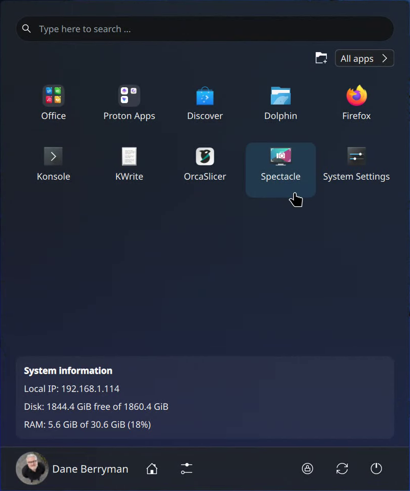
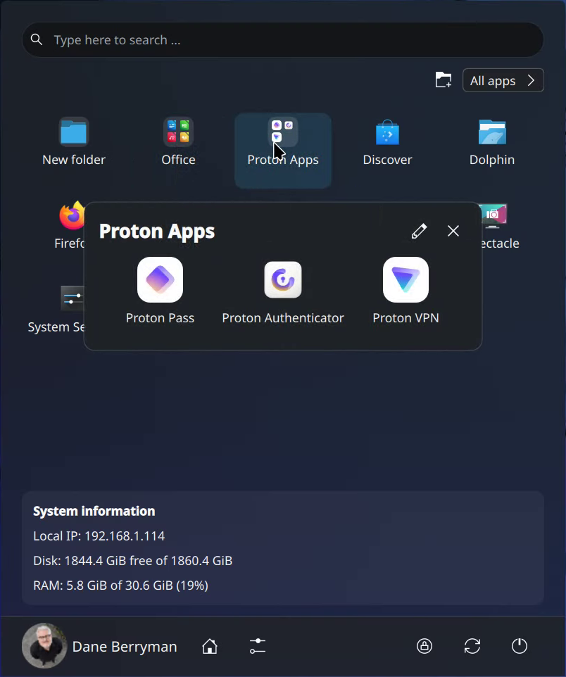
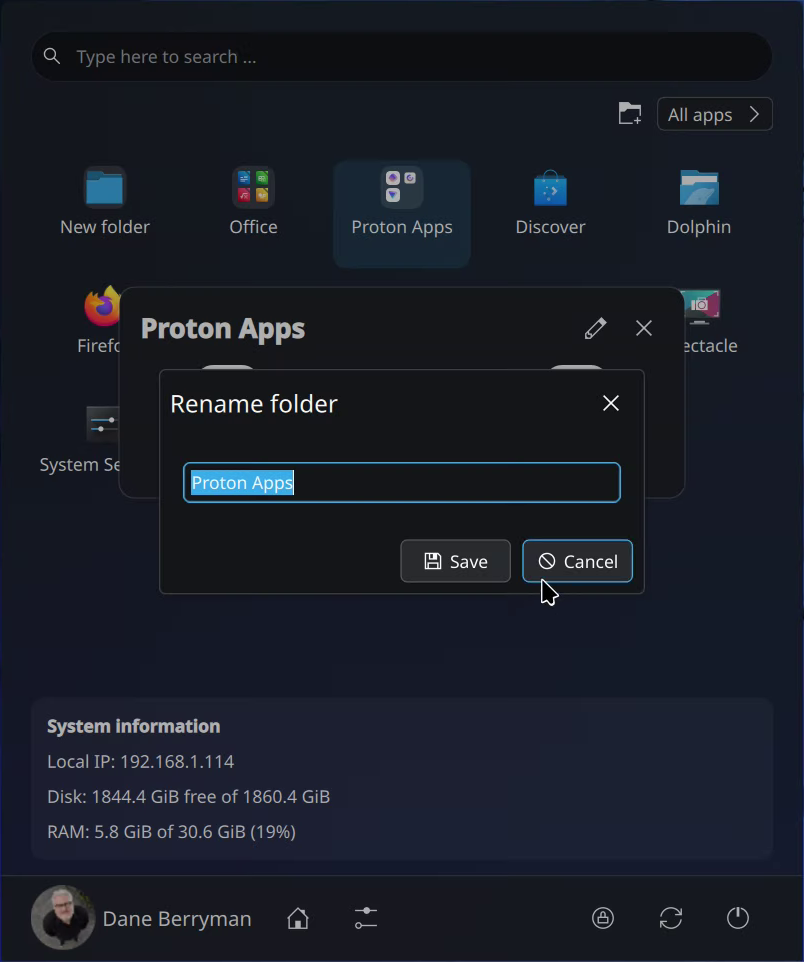

# Menu 11 Next Level

An application launcher for KDE Plasma 6 with drag-and-drop folders, configurable favourites, and a compact system information panel.

<p>
  
</p>

## Screenshots

| Open folder | Rename a folder |
| --- | --- |
|  |  |

Screenshots captured from the app running on Fedora KDE.

## Features

- Launch apps from your favourites, folders, search results, or the All Apps page.
- Organise favourites into folders by dragging one app onto another.
- Sort favourites manually, A–Z, folders first, or folders last.
- Highlight newly installed apps in All Apps, with an optional New badge.
- Browse All Apps in list, grid, or category view, with its own sorting and folders.
- Adjust the app icon size, grid rows and columns, launcher button image, and menu position.
- Show a circular profile picture with an adjustable size. Click the profile area to open **System Settings → Users**.
- Choose whether to show your local IP address, disk space, and RAM usage.
- Optionally show recently opened apps, a quick actions bar, and weather.
- Search for apps, use the command palette or calculator, and access session and power controls.

## Requirements

- KDE Plasma 6 and its standard KDE QML modules. Tested on Fedora KDE with Plasma **6.7.5**; Plasma 5 is not supported.
- `kpackagetool6` to install or update the widget.
- Python 3 and the `ip` command from iproute/iproute2 for the system information panel.
- An internet connection for optional weather and GitHub update checks.

The launcher does not require building the legacy weather plugin included in the repository. Weather is fetched from Open-Meteo using the location selected in settings.

## Install from source

```sh
git clone https://github.com/dane-berryman/menu-11-next-level.git
cd menu-11-next-level
kpackagetool6 --type Plasma/Applet --install .
```

Open Plasma's **Add Widgets** panel, search for **Menu 11 Next Level**, and add it to your panel or desktop.

To replace an existing panel launcher, right-click its icon, choose **Show Alternatives**, and select **Menu 11 Next Level**. Installation alone does not replace your current launcher.

If you have a packaged `.plasmoid` file, use **Add Widgets → Get New Widgets → Install Widget From Local File**, or install it with:

```sh
kpackagetool6 --type Plasma/Applet --install /path/to/menu-11-next-level.plasmoid
```

### Update

From an existing source checkout:

```sh
git pull --ff-only
kpackagetool6 --type Plasma/Applet --upgrade .
```

An existing widget may keep its loaded QML after an update. Log out and back in to load the new version while preserving its configuration.

### Uninstall

```sh
kpackagetool6 --type Plasma/Applet --remove menu.11.next.level
```

## Using favourite folders

| Action | How |
| --- | --- |
| Create a folder | Drag an app onto the **centre** of another favourite, then release. |
| Create an empty folder | Click the folder button above the favourites grid. |
| Add an app | Drop it onto the centre of a folder tile. |
| Reorder tiles | Drop near a tile's **left or right edge**. An insertion line shows the position. |
| Open a folder | Click its tile. |
| Rename a folder | Click the pencil beside its title, enter a name, then **Save**. **Cancel** leaves the name unchanged. |
| Move an app out | Drag it from the open folder onto empty grid space or a tile edge. You can also right-click it and choose **Move out of folder**. |
| Dissolve a folder | Right-click its tile and choose **Dissolve folder**. Its apps return to the grid. |
| Unpin an app | Right-click an app tile and choose **Unpin application**. |

Folder membership and tile order are saved for each widget. Grouping or dissolving a folder does not remove its apps from KDE's underlying favourites.

## Configuration

Right-click the launcher and open **Configure → General**.

### Favourite sorting

- **Manual:** arrange apps and folders by dragging.
- **A–Z:** sort apps and folders together by name.
- **Folders first:** folders first, then apps; each group is sorted A–Z.
- **Folders last:** apps first, then folders; each group is sorted A–Z.

Dropping between tiles switches back to manual ordering.

### Newly installed apps

Enable or disable **Highlight newly installed apps** under the All Apps settings.
Apps added after the first scan get a subtle highlight and a **New** badge. The badge
clears when you launch the app through this launcher, or after seven days.
Existing apps are not marked on the initial scan. Detection is saved between sessions;
turning the setting off hides highlights without changing the app list.

### Profile and system information

Set the profile picture size from **24 to 96 pixels**. The image comes from your KDE user profile; change it in **System Settings → Users**.

The system information switches are independent:

- **Local IP:** the source address selected by the computer's routing table, rather than a public-IP lookup.
- **Disk space:** free and total space on the filesystem containing your home folder.
- **RAM:** used memory, total memory, and percentage used. Available memory is excluded from the used amount.

These readings refresh every **five seconds while the menu is open**. Collecting them makes no network requests. Weather and update checks are separate online features.

### Other options

Settings also cover app icon size, grid dimensions, menu position, the launcher icon or image, All Apps view and sort order, recently opened apps, quick actions, weather location, the shell runner, and visible Sleep, Restart, and Shutdown buttons.

Recent documents are not displayed.

## Search and keyboard controls

- Type in the search field to find apps and other enabled Plasma search results.
- Start with `/` to open the command palette; use `/calc 2+2` for a calculation.
- Start with `>` to run a shell command when the shell runner is enabled.
- **Ctrl+1–9:** activate a favourite on the current page, including opening a folder.
- **Alt+1–9:** launch a search result.
- **Arrow keys:** navigate the favourites grid.
- **Page Up / Page Down:** change favourites pages.
- **Home / End:** jump to the first or last favourites page.
- **Enter / Space:** activate the selected favourite.
- **Escape:** close an open folder or rename dialog.

## Development checks

Tests require Python 3, PySide6, and the system KDE QML modules:

```sh
QT_QPA_PLATFORM=offscreen python3 -m unittest discover -s tests -p 'test_*.py'
```

The tests cover app activation, folder creation and drag-out, reordering, renaming with Save/Cancel, sorting, keyboard interaction, legacy folder data, and system information parsing. They run without opening application windows.

## Credits and licence

Based on [Menu 11 Next](https://github.com/Eisteed/menu-11-next), with roots in [OnzeMenuKDE](https://github.com/adhec/OnzeMenuKDE). Original author credits are retained in the source.

Licensed under **GPL-2.0-or-later**, as declared in the package metadata and source headers.

Report problems in this fork's [issue tracker](https://github.com/dane-berryman/menu-11-next-level/issues).
